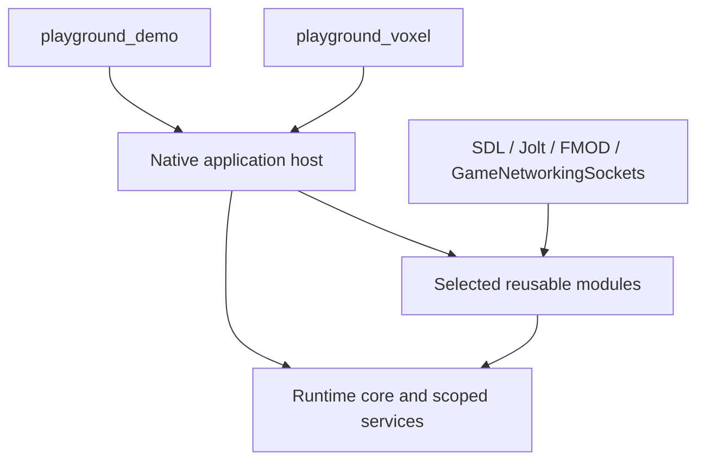

# Runtime architecture and scope

Playground hosts trusted applications through explicit lifetimes, scoped services
and publication boundaries. Applications select reusable modules and own their
behavior. An application can be a viewer, collaboration tool, game or launcher.

## Layers and dependency direction

| Layer | Responsibility | Excludes |
|---|---|---|
| Runtime core | IDs/epochs, scoped lifetime, work admission, completion, publication, accounting and diagnostics | Application rules, native solver/device objects, required scene graph |
| Optional modules | UI, rendering/scenes, assets/storage, world coordinates, spatial datasets, physics, audio, networking | Automatic application construction or mandatory use by every consumer |
| Native adapters | SDL presentation, Jolt, FMOD and GameNetworkingSockets | Public native handles in portable module APIs |
| Applications | Models, composition, controls, source/recipe implementations and policy | Ownership of shared host devices through accidental globals |

Dependencies point from applications/adapters to reusable contracts. Dataset and
world tools run without SDL video, fonts, UI or a renderer. Basic math remains a
small value library; advanced spatial indexes are optional implementations. Neither
an ECS nor a universal behavior tree, material model or message bus is required.

## Build and composition targets

| Target | Contents |
|---|---|
| `playground_lib` | Public CMake aggregate of reusable modules, preserving direct module linkage |
| `playground_demo` | Launcher, existing UI/scene fixtures, physics and volume viewers |
| `playground_voxel` | Separate application entrypoint for procedural terrain and material experiments |

Retain internal targets such as playground_runtime, playground_world,
playground_assets, playground_scene and playground_sdl. Introduce focused module
and adapter targets for new services. The aggregate does not flatten ownership or
force headless consumers to link presentation. Native dependencies are PRIVATE
unless a public adapter header requires them; neutral APIs contain no native types.

Extract host/session code from concrete application registrations. Each executable
supplies its own catalog construction, factory registry, initial app and shell
policy. A mono-app distribution and a launcher distribution use the same launch
sequence. Neither the library nor host constructor names Bistro or a menu.

Optional dependencies have explicit build switches and runtime capability reports.
Disabled Jolt, FMOD or transport adapters must not be fetched, initialized or linked
incidentally. CMake pins native source dependencies; externally supplied SDKs record
and validate an exact supported version and target. FMOD packaging is conditional
on a supplied SDK and applicable redistribution terms. No SDK download credentials
or vendor binaries belong in the source tree.

## Stable boundaries

Reuse ServicePump/ServiceScope, Executor, CompletionQueue, ActivationLifetime,
ResourceLedger, AssetCatalog, WorldSnapshot and existing render resource handles.
New services extend these contracts rather than creating parallel lifecycle or
accounting frameworks. Resource ownership is distinct from logical demand, thread
safety, GPU completion and permission. Native trusted extensions are not isolated.

Every cross-owner API specifies inputs, units, identity/epoch, calling thread,
admission outcome, publication boundary, retained result and retirement behavior.
Completion wakes are notifications; the service owns the result. Accepted work is
not completed work, and committed model state is not necessarily durable state.

Use typed requests/results and snapshots at concrete boundaries. A universal
serialized command envelope is not required for native calls. Network/guest codecs
translate validated values explicitly. Independent services need not share a clock,
worker pool implementation or atomic transaction.

## Required optional modules

Rendering retains meshes, materials, textures and explicit capability negotiation.
Content services retain typed identity, bounded acquisition, immutable definitions
and independent device realizations. Saved [composition](COMPOSITION.md) references
those definitions and registered behavior configuration without serializing code.

Spatial services support finite manifests and bounded paged discovery for mesh cells or datasets, precise
coordinates, independently ready products and durable state. "Infinite" sources
resolve previously unvisited addresses within declared finite numeric bounds;
resident data and work remain bounded. Chunk size, tree layout, generation rules
and region shape are not runtime-core contracts.

Bounded voxel data, edits and scalar/label presentation belong to optional sampled-
data modules. Baseline adapters cover `.vox` and a declared NRRD subset, exposed-face
meshes and scalar slices. Application-defined meaning does not require one entity
per sample. Small regional simulation provides ordering and activation; applications
supply kernels. It is not a prerequisite for loaded static data.

Jolt realizes physical bodies and queries. FMOD realizes audio playback and authored
Studio events. GameNetworkingSockets realizes message transport. An optional session
module provides ordered authority, filtered baselines and replicas for collaborative
and real-time domains. Enabling networking never forces world/voxel replication.

## Application and future scope

Demo views, controls and workflows remain application requirements. Locomotion,
camera rigs and navigation are optional utilities; their algorithms do not prescribe
the application model or block storage/physics acceptance. Terrain rules, general
fracture, water, inventories and other domain simulations belong to prototypes.

One resident native application with one foreground presentation is the initial
host policy. Instance lifetime, suspension and presentation attachment remain
separate so concurrent background apps and multiple windows can be added later.
A retained replacement candidate is not a second active application. Downloaded
logic, isolation, hot code replacement, storefronts and remote installation remain
[future](DISTRIBUTED_APPS.md). Built-in startup selection is required now.

## Completion evidence

[Host verification](HOST_TESTING.md) defines composition and service-ordering evidence.
[Spatial verification](SPATIAL_TESTING.md) uses both label volumes and scalar fields.
Native adapter tests prove actual solver/device/transport behavior separately from
fake-provider sequencing. Performance records identify build, hardware, input trace
and budgets. A capability is supported only after its relevant checks pass; a
skipped native test is untested coverage. Internal representations remain replaceable
without altering these guarantees.
